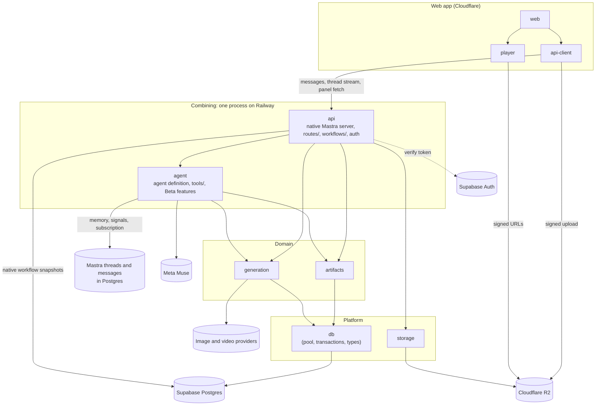
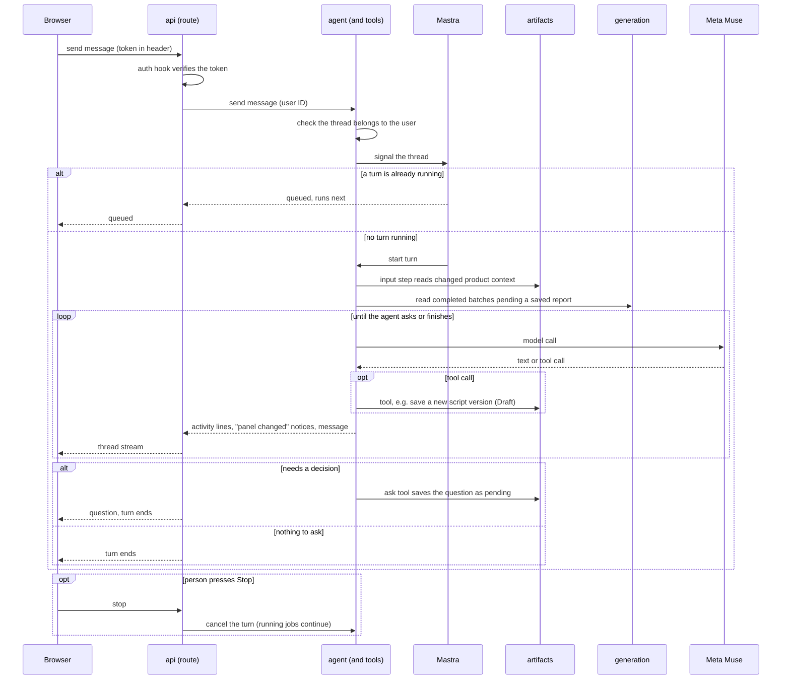
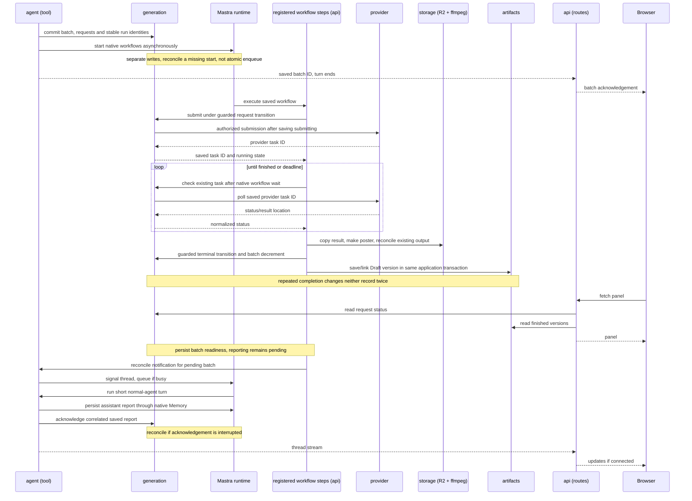

# Workprint — Architecture Background

**Status:** Architectural background migrated to Workprint on 2026-10-27 from the 2026-10-19 direction. The application is not implemented or runtime-qualified. The [README](../README.md) describes the actual repository state; the [litepaper](litepaper.md) records product vision.

**Current MVP scope takes precedence over historical detail below.** The approved implementation spec and sprint are local maintainer planning records, intentionally absent from public clones. Current scope is one video/Narrative Scene, four workspace tabs, exact human review/choices, server-configured Muse models, independent generation, single-clip playback and stream-copy export of compatible full clips. Deletion/retention workflows, model selectors/preferences, spending caps, usage totals/completeness, audio-reference or separate-audio generation, Editor/timeline work, clip conversion, Play all/comparison playback and Project/multi-scene composition are deferred. Typed chat is not an approval/answer; proposal cards approve only the exact shown snapshot. No paid call or deployment is authorized by this document.

The detailed lifecycle, API inventory and module notes below retain the earlier broader architecture for rationale, not additional current requirements. References to deferred behavior, the earlier folder layout or still-pending B-020 are historical. Current modules also include `application`, `contracts`, `exports`, `usage` and configuration-only `model-catalog`; assistant bindings live under `agent/mastra`, separate from backend `mastra` composition, in one instance. Both modules and native behavior are qualified through the owning implementation stories. Obtain the approved local plan before implementing; do not infer contracts from these background examples.

[Architecture — lite](architecture-lite.md) summarizes this direction, its application operations, component boundaries and open decisions.

## Contents

1. [Film production lifecycle](#film-production-lifecycle)
2. [Tech stack](#tech-stack)
   - [Frontend](#frontend) — decided
   - [Agent harness](#agent-harness) — decided
   - [Infrastructure and services](#infrastructure-and-services) — decided
3. [Principles](#principles): portability, connections and authorization — decided
4. [Flow diagram](#flow-diagram): how the modules interact — agreed
5. [API surface](#api-surface): core operations, not endpoint contracts
6. [Module breakdown](#module-breakdown): what each module is and does — agreed

## Film production lifecycle

**Script → Visual and audio references → Storyboard → Video Takes → Edit, finish and export**

1. **Script.** Start with an idea, brief, source text or existing script. Draft or refine what happens: Narrative Scenes, Shots, dialogue and overall look. The person reviews the story.
2. **Asset sheets and audio references.** Identify characters, places and props; reuse supplied or saved references, or develop visual sheets. Where needed, add authorised character voice samples, pronunciation/performance notes and ambience/music references. The person approves their intended use. References support consistency, not guaranteed identity.
3. **Storyboard.** Plan each Shot's framing, camera movement, action, approximate duration, dialogue and sound cues. Generate visual Storyboard Panels from the script and asset references; review clarity and continuity, then approve the visual plan.
4. **Video Takes.** Prepare generation requests from the storyboard using only references and settings supported by the selected model. Generate candidate Takes, check picture and any provisional audio, and let the person choose or request alternatives. Keep versions; chosen Takes are not a finished film.
5. **Edit, finish and export.** Shape chosen material through timing, pacing, picture and available audio; add music, effects, titles or captions only as needed. Mixed generated sound remains **Original audio** unless separate media exists. The person can use direct controls or ask the assistant to change the same edit without overwriting originals. Review the result and export; no mandatory edit or Editor visit is required before export.

**Audio reference note.** Establish voice, pronunciation and delivery references for characters, ambience references for locations, and optional music mood/style references during the asset-reference stage. These guide later generation and review; send audio references to a provider only where supported and authorised. References define the target, not an approved dialogue performance.

People can enter at the relevant stage with existing material and loop back. Upstream changes identify dependent work to recheck, not automatically regenerate everything. This is hosted-product intent, not a runtime capability claim: audio-reference inputs and voice/audio generation, like detailed editing and export, remain unresolved. The earlier local prototype's video adapter accepted text and up to two endpoint images, not audio references; it is not imported here and does not qualify hosted Muse behavior. Hosted capabilities and approval/disclosure rules are established by their owning implementation stories. [Canonical terms](../CONTEXT.md) distinguish Shots, Panels, Frames and version-specific approvals.

## Tech stack

### Decided earlier

**Where the agent runs** (2026-10-04): on our own server, not in a hosted sandbox per session.

- **State in Postgres:** threads and our product data (versioned artifacts and jobs) are stored in Postgres, and clients replay them to show the thread and panel, and to reconnect. How threads are stored was settled with the [agent harness](#agent-harness).
- **Long work:** image and video generation run as background jobs that can take 20 minutes or more. An agent turn requests the work and ends; when the batch finishes, the agent is woken for the next turn (see [background jobs](#background-jobs)). The agent never waits on a running generation.
- **Sandbox (later, not in the MVP):** used only if the agent needs to run code it wrote itself, started per job, with no credentials, and thrown away afterwards.

**Language:** TypeScript for the frontend and the backend (2026-10-06).

**Platform:** a web app only for now (2026-10-06): desktop web first, with the single-column layout on phones from the [design](design/design.md). No native mobile or desktop app.

### Frontend

**Decision** (2026-10-06): **React 19 + Vite, built as a single-page TypeScript app.** Research: frontend framework, October 2026 (local maintainer research).

**Why:**

- **It's a logged-in, highly interactive app.** It needs no server-side rendering for search engines; a marketing site can be separate. That rules out Next.js and its server complexity.
- **Editors get their speed outside the framework.** Every browser editor researched draws frame-critical work with canvas, WebGL/WebGPU, Wasm or WebCodecs, and uses React (Runway, Descript, Figma's interface, Canva, Linear, tldraw, LTX Studio) or no framework (VS Code) for the interface around it.
- **Ecosystem and accessibility.** React has the deepest set of editor, media and accessibility libraries, and coding agents write it most reliably.
- **Performance gap is manageable.** React is about 1.6× slower than Solid or Svelte at updating the page; that matters little once playback, drag and streaming state live outside it.

**How the frontend is structured:** a thin React layer over framework-free packages, so the heavy parts can move to another framework, or to raw performance code, without rewriting them.

| Package | Framework | Responsibility |
|---|---|---|
| Web app (`web`) | React | Screens, panels, tabs, chat, question cards and viewers from the [design system](design/design.md) |
| API client (`api-client`) | None (plain TypeScript) | Sends messages, streams the thread (agent output and panel updates), reconnects |
| Player (`player`) | None | Decoding and playback with WebCodecs via Mediabunny; the scene player now, a timeline editor later |
| Editor engines (later) | None | Future storyboard canvas, timeline and 3D view, drawing to canvas, WebGL or WebGPU |
| Design tokens | None | The values in [design.md](design/design.md) as CSS variables |

**Rules:**

- Fast-changing state (playback position, drag, streaming text) lives in the framework-free packages; React reads it without re-rendering on every change.
- Accessible building blocks come from **React Aria** (focus management, keyboard access, announcements), to meet the requirements in [design.md](design/design.md#accessibility).
- **Not used for now:** Next.js (no server rendering needed); Remotion (React-only, and video-editor products need its paid Automator licence, $0.01 per render with a $100/month minimum); tldraw (paid commercial key). Revisit when building editors.

**Alternatives considered:** SolidJS (fastest, but 2.0 is still a release candidate and its ecosystem is thin); Svelte 5 (a reasonable second choice, but in a major-version change); no framework (we'd build our own reactivity, routing and accessibility); Next.js (server rendering we don't need).

### Agent harness

**Decision** (2026-10-06): **Mastra**, in TypeScript, at a pinned exact version, running on our own server with Postgres. Research: agent harness, October 2026 (local maintainer research).

**What we use from Mastra:**

| Feature | Used for | Status |
|---|---|---|
| Agents and tools | The tool loop, streaming and tool calling for each turn | Stable |
| Memory | Threads, stored in Postgres in Mastra's own schema inside our database; observational memory summarises long threads (see [compaction](#compaction)) | Stable |
| Skills | `SKILL.md` packages loaded on demand (`skill`, `skill_read`, `skill_search`), following the Agent Skills spec | Stable |
| Signals and thread subscription | Queue messages, notify the agent of finished batches, and reattach to live turns | Beta; qualify the selected version |
| Workflows | Background generation steps, saved execution state and recovery | Preferred; qualification pending |
| Studio | Tracing and debugging | Stable |

Mastra uses the [Vercel AI SDK](https://ai-sdk.dev) for model integration and message handling. Prefer supported native transport, subscription, stream-reading and history-conversion helpers over custom protocol machinery. Our framework-free `api-client` owns authenticated product requests and presentation state; React reads from it. A React chat hook is not required. The selected helpers must support our queued turns, background wake-ups and live reattachment; a request-bound chat route is not assumed to be interchangeable.

**How we use it:**

- **Pinned version.** Select and pin a compatible Mastra/AI SDK package set during implementation. Upgrades require release-note review and behavior verification. The 2026-10-19 research inspected `@mastra/core@1.78.0` source; that is evidence, not an installed or qualified dependency selection.
- **Thin native integration.** Only `agent` calls the signals and thread-subscription APIs. Application workflows are registered in `api`; Mastra owns their execution and snapshots. Do not build another agent loop, scheduler or conversation store.
- **Behaviour tests on every upgrade:** queued messages, finished-batch reporting, history/live reattachment, interrupted turns, Stop without cancelling generation, manual-change context, and asking a question ending the turn. Recovery must not silently duplicate paid work or declare an unsaved response complete.
- **Current model-family direction: Meta Muse** (2026-10-27). Exact assistant/image/video IDs, capabilities and the supported Mastra/provider integration must be verified before enabling them. Image/video generation is tool-driven, separate from assistant inference; no native Muse compatibility is assumed from this selection.
- **Short turns, independent generation.** A normal agent requests work, returns a saved batch ID and ends its turn. Native workflows move generation requests forward independently; completion is reconciled into a later agent turn. Do not hold the conversation request open with `untilIdle` just to wait for media. See [background jobs](#background-jobs).
- **Storage split.** Mastra owns conversation records and workflow snapshots in Postgres. Our tables own versioned artifacts, approvals, generation requests, provider task IDs and batch/reporting records. These are product state, not a second workflow engine. Artifacts belong to the account; threads link to them by exact version. We never add columns to or change Mastra's tables.
- **No sub-agents in the MVP.**

**Background execution — preferred, qualification pending:** use Mastra's default-engine workflows with Postgres persistence and asynchronous starts. This does not require DurableAgent, Redis or Inngest. `api` registers the workflow definitions and application recovery hooks; `generation` owns provider operations and request state. A background-tool flag alone is not the design: task executor recovery, model-controlled execution overrides and completion delivery have different semantics.

**Qualification and fallback:** prove persisted dispatch, production startup recovery, polling, cancellation, bounded concurrency and safe repeated execution before relying on this approach. Application writes cannot atomically include a Mastra workflow start; the [hand-off rule](#background-jobs) must close that gap. Keep pg-boss only as an alternative if a demonstrated queue or transactional-enqueue requirement cannot be met simply. Do not run both orchestration systems for the same work or build a custom queue to avoid choosing.

Sources: Mastra [workflows](https://mastra.ai/docs/workflows/overview), [asynchronous starts](https://mastra.ai/reference/workflows/run-methods/start-async), [background tasks](https://mastra.ai/docs/harness/background-tasks), and [error handling](https://mastra.ai/docs/workflows/error-handling). The older local harness research records the previous pg-boss choice; this revision supersedes that choice, not its provider-safety requirements.

**Not in the MVP:**

- **Long unattended runs** (for example "make the whole film overnight", with many steps and sub-agents). Revisit only when a concrete production flow needs them; no alternative-framework migration is preselected.
- **Durable agents:** retain normal agents for the MVP's short turns; long image/video provider jobs alone do not require durable agents. If future long-running or multi-step agent execution must resume across crashes or deployments, evaluate migration to [Mastra durable agents](https://mastra.ai/docs/agents/durable-agents). This requires validating recovery, checkpoints and safe side-effect retries, not just swapping runtimes.
- **Multiple backend instances:** start with one application instance. Default thread coordination is process-local; additional instances need qualified shared event delivery and ownership, including deployment overlap. Mastra documents [distributed PubSub](https://mastra.ai/docs/server/pubsub), but none is selected for the MVP. Isolate heavy rendering in separately resourced workers if measurements require it; that is not a reason to split the API and agent prematurely.

#### Compaction

Use Mastra's observational memory to summarize long conversations without replacing the thread or its stored messages. Product state—scripts, versions, choices and questions—still comes from our tables at the start of a turn, not from a chat summary. Do not add a custom summarization service.

**To qualify:** the selected version's memory configuration, Muse model integration, thresholds, retention of creative decisions and history presentation. Tune these with representative conversations rather than fixing token thresholds in the architecture.

#### Alternatives and rationale

Mastra remains selected because its agent loop, memory, skills and execution primitives reduce framework code we would otherwise maintain. Earlier framework and job-runner comparisons remain in local maintainer harness research; they are dated evidence, not a list of additional MVP components or predetermined migrations.

### Infrastructure and services

**Decisions** (2026-10-06). Research: infrastructure, October 2026 (local maintainer research).

| Need | Provider | Notes |
|---|---|---|
| Backend hosting | **Railway**, running our Docker images | One application instance: Mastra's native Node.js HTTP server, our registered routes and native workflows. FFmpeg runs as a bounded asynchronous subprocess, not JavaScript on the event loop. Capacity and cost depend on concurrent turns/jobs, not registered-user count; see [connections](#connections) and [background jobs](#background-jobs) |
| Region | **Singapore** | Backend and database in the same region (Railway's Singapore region to be confirmed) |
| Frontend hosting | **Cloudflare Workers static assets** | Free static hosting with preview deploys |
| Database | **Supabase Postgres** | Application tables plus Mastra conversation/workflow storage. Use a direct connection or session pooler suitable for a persistent backend; transaction pooling is not selected. Bound the total connection budget, including SDK pools and deployment overlap |
| Schema and migrations | **Supabase declarative schemas** | SQL files in `supabase/schemas/` own our tables; generated migrations and separate seed data follow that source. Mastra manages its schema, excluded from application declarative diffs. Privileged schema preparation is separate from restricted runtime access; exact commands, grants and initialization are qualified in the MVP spec |
| Queries | **Plain SQL through `pg`**, with **Supabase-generated types** | No ORM or query builder. Each module owns its SQL. Prefer a shared bounded pool where the selected adapters support it; verify pool ownership and cleanup rather than assuming every library shares it |
| Sign-in | **Supabase Auth** | Users live in our database. The backend verifies Supabase's tokens in Mastra's auth hook. The frontend and API share a parent domain (`app.` and `api.`) |
| Media storage | **Cloudflare R2** | Original MP4s played directly; no video platform. Posters made by ffmpeg in a job. Signed URLs for private media |
| The assistant's model | **Meta Muse, subject to qualification** | See [agent harness](#agent-harness) |
| Image and video models | **Meta Muse direction; exact APIs/models to qualify** | Called through our own generation interface (submit, check status, cancel), which turns each provider's statuses and errors into ours, so the provider can be chosen and changed later. Status is polled for the MVP; callbacks later. How providers run jobs: local video-provider research |
| Error monitoring | **Sentry** | Thread, turn and job IDs attached to every error |

**Later, not in the MVP stack:** payments and credits (Stripe was the research pick), content moderation, assistant tracing, log management, a dedicated email sender for sign-in mail (Supabase's built-in email is fine for testing), and product analytics. Options for each are in local maintainer infrastructure research.

**Alternatives considered:** Render for hosting (the runner-up); Neon, PlanetScale and others for the database; Drizzle and Kysely for queries; Better Auth, WorkOS and Clerk for sign-in; S3 with CloudFront for storage. Details remain in local maintainer infrastructure research.

## Principles

### Portability

We start on managed platforms because they are cheaper and simpler than AWS for an MVP, and expect to move to AWS once we have credits and real usage. To keep that move cheap:

- **Containers.** Everything runs from Dockerfiles; on AWS the same images run on ECS.
- **Standard Postgres.** No Supabase-only features in app logic: no Edge Functions, Realtime or auto-generated data API. Our server does that work. Moving is a dump and restore, or replication.
- **Storage through the S3 API.** R2 and S3 speak the same API; moving is configuration plus copying files.
- **Configuration through environment variables.** No platform SDKs inside app code.
- **Our own interfaces at the edges:** `agent` (Mastra's Beta features), `generation` (image and video models), `db` and each module's SQL, the sign-in check (Supabase Auth tokens in the auth hook) and `storage` (files). Changing a provider touches one module.
- **Sign-in data stays ours.** Supabase Auth keeps users and bcrypt password hashes in our database, and runs on open-source software (GoTrue) that can be self-hosted.

### Connections

The browser subscribes while a turn or generation is active and the tab is visible. Closing that observation connection must not cancel the turn or its generations. On return it reloads saved history and product state, then reattaches to any turn still running in the same server process. Qualify the selected native subscription/history helpers for this behavior; do not assume request-bound chat transport provides it. While "Making…" items exist, refresh the panel at a bounded interval.

Use authenticated SSE over `fetch`, idle heartbeats and reconnect with backoff. Railway currently documents a 15-minute HTTP request ceiling and five-minute inactivity limit; heartbeats do not defeat the total duration limit ([network limits](https://docs.railway.com/networking/public-networking/specs-and-limits)). Check every proxy in the path. Exact heartbeat, refresh and signed-URL cache settings belong in implementation configuration.

A process restart is different from a network disconnect: saved state survives, but a normal agent's unfinished turn does not automatically resume. Show interrupted or unconfirmed work honestly. Reconnecting reads and observes; it never blindly resubmits a message, approval or paid generation. A streamed finish is not a persistence acknowledgement. Ignore late responses from an outgoing account or a thread no longer being displayed.

### Authorization

- **One identity source.** Supabase Auth issues tokens; Mastra's configured native auth hook verifies protected requests. Reuse supported verification callbacks rather than adding a separate JWT/authentication service.
- **Explicit public surface.** Our deployment must deny native endpoints unless explicitly allow-listed; do not assume SDK defaults make them private. Allow-list operations, methods and inputs, and apply the same owner-scoped policy to native and product routes. A client-supplied thread ID is a reference to authorize, never identity.
- **Closed inputs.** Reject forged roles, foreign references, arbitrary history, execution options and approval claims before writes or inference. Model-selected tool inputs cannot override permissions, spending caps or paid-submission retry policy. Concrete schemas are defined in the MVP spec.
- **The user is the resource.** The verified user's ID is Mastra's resource ID, and every thread belongs to one user.
- **Check ownership in the owning module.** Routes pass verified identity; tools pass trusted thread ownership; workflow steps use the saved owner and recheck current authorization before effects. Module actions check their own items. Neither client nor model input supplies trusted identity.
- **Private surfaces and bounded admission.** Keep Studio, admin and diagnostic routes private. Verify the effective native route surface, including framework-public routes. Enforce body limits before unbounded parsing; select a proxy only if the chosen server/host cannot enforce the required boundary. No additional proxy product is selected here.
- **Account deletion.** Close new admissions and prevent late turns/workflows from recreating erased data. Request cancellation, but do not treat that as settlement. Database/Auth deletion and R2 cleanup are not one transaction; retain retryable file cleanup and report failure or uncertainty explicitly. The MVP spec must establish enforcement without silently modifying Mastra's schema.

## Flow diagram

**Direction revised 2026-10-19.** [Module breakdown](#module-breakdown) gives each module's responsibilities. The existing three-layer structure remains: Mastra server configuration/routes/workflows in `api`, the assistant/tools/thread integration in `agent`, product data in domain modules, and mechanical adapters below them. The diagrams show the preferred native-workflow path, subject to qualification—not a proven running application.

### What Mastra supplies and what we write

| Concern | Supplied by | We write or configure |
|---|---|---|
| Web server, routing, streaming, auth hook | Mastra's native server on Railway | Register product routes; configure verified identity, closed inputs and the permitted native surface—not another HTTP server |
| Model calls, the tool loop, tool validation and dispatch | Mastra agent runtime | The assistant's instructions, model settings and tools |
| Thread storage, history and memory | Mastra Memory + PostgresStore | The user-to-resource mapping; memory settings |
| Queued messages, wake-ups, reconnecting | Mastra signals and thread subscription (Beta) | Called only from our `agent` module |
| Starting a turn | Mastra's registered normal agent | Authorized signals and reconciliation of application hand-offs through `agent` |
| Background execution | Mastra workflows + Postgres snapshots, subject to qualification | Generation steps, safe provider effects, request/run correlation and recoverable application hand-offs |
| Skill loading | Mastra skills | The `SKILL.md` packages |
| Tools | Mastra `createTool` | Each tool's behaviour, in the `agent` module's `tools/` folder |
| Artifacts, generation, storage | — | Our modules below |
| Sign-in and tokens | Supabase Auth | Sign-in settings |

### Modules

Two deployables: the **web app** (static, on Cloudflare) and the **backend**, one Node process on Railway for the MVP. The backend has three layers.

| Layer | Module | Job |
|---|---|---|
| Frontend | `web` | React screens: chat, panel tabs, question cards, viewers, sign-in |
| | `api-client` | Framework-free: authenticated product requests, native stream/history helpers, reconnect/reconciliation and panel fetching |
| | `player` | Framework-free: decode and play videos (Mediabunny / WebCodecs), including Play all |
| Combining | `api` | Configures the native Mastra server, agent, storage and auth; registers routes (`routes/`) and workflows (`workflows/`). Handlers and steps combine domain actions without owning their business rules. The backend app is `apps/api`; this layer lives in `src/mastra/` |
| | `agent` | Normal Mastra agent: instructions, model, memory, skills and authoritative product context from `artifacts`/`generation`. Input preparation does not mark batches reported. Owns trusted thread access and the native queue/wake/subscription integration. Tools live in `src/mastra/tools/`; `ask` saves a question and ends the turn |
| Domain | `artifacts` | Everything the account makes or uploads (scripts, character and place sheets, looks, storyboard panels, videos), with every version and its file. Each thread's links: the version of each artifact it uses (for a shot, the chosen video) and whether it is approved there. Questions (pending or answered), what changed since the last turn, and deletion with a 30-day delay. The Library screen lists these artifacts by kind. Provider-neutral: never stores a provider's IDs; those stay in `generation`. The thread itself stays in Mastra |
| | `generation` | Generation requests and their states (the panel's "Making…" items), batches, our provider interface (submit, check status, cancel) with one adapter per image or video provider, and the spend guard. Refers to its inputs by version ID and keeps the thread ID only as a reference; never calls `artifacts` |
| Platform | `storage` | R2 files (signed upload and download URLs, copying provider outputs, deleting) and ffmpeg (posters, image sizes) |
| | `db` | Bounded Postgres access, transaction helper and generated types; no separate job runner in the preferred design |

**Module rules:**

- **Each module owns its tables and SQL.** Its tables are declared in `supabase/schemas/<module>.sql` (Supabase reads schemas only from there) and its queries live in its own folder. It exposes actions (for example `artifacts.saveVersion`, `generation.request`), and checks ownership: every action takes the signed-in user's ID and checks that its own items belong to that user. Callers pass the ID in; they don't check ownership themselves.
- **The rules are checked, not just written.** A dependency-cruiser config fails the build when a domain module imports another domain module, a platform module imports anything above it, or imports form a cycle.
- **Only the combining layer combines modules:** routes and workflow steps in `api`, and the agent's tools and input step. Domain modules don't call each other; they use only platform modules. Supply native workflow collaborators through composition rather than importing the assembled Mastra singleton into domain modules.
- **Artifacts belong to the account; threads link to them.** Each artifact is owned by the user (Mastra's resource ID) and records the thread it was made in. A thread has one link per artifact it uses, which says which version it uses and whether it is approved there. Many threads can link the same artifact, each at its own version. A link stays on its version (pinned) except as the link rule below allows; when a newer version exists, the thread offers it ("Vale has a newer version · Use version 3?"). Mastra's `threads` row is the thread record; we link to Mastra's tables and never change them. If films later span several threads, a project layer is added then by migration; this is an open product question.
- **Nothing is copied.** Each file is stored once, as one version of one artifact. Threads, generation requests and the Library refer to it by ID.
- **Versions never change once saved.** Only a deleted time can be set later. A version stores its file key, poster key, size and content type (empty for text, such as a script). Keys start with the user ID, then the request or upload ID, so each key belongs to one version and deleting an account removes one prefix. A change makes a new version.
- **Approval belongs to the thread, not the version.** Approval means a version is accepted for a use, and the thread is the use. A version the agent made is a draft in the thread until the person approves it; a version the person attaches, picks, chooses, switches to or edits counts as approved. Approval is set only by the person's own actions (answering an approval question, attaching, picking, choosing, switching, editing); no agent tool can set it. The Library, outside any thread, shows versions without Draft or Ready.
- **A new version and the thread's link.** A version the person makes by editing moves the thread's link to it, approved. A version the agent or a generation makes is linked to the thread unapproved (Draft); if the thread already links that artifact, the link moves only when its current version is unapproved. An approved version stays, and the new one is offered ("Use version 2?"); the agent can't switch it without asking through `ask`.
- **The caller owns the application transaction.** It opens it with `db` and passes it to the domain actions being combined. Mastra workflow starts, snapshots and conversation writes do not join it. Commit product state and its stable hand-off identity first, then invoke Mastra; reconcile a missing start or acknowledgement after failure. This is not atomic enqueue and does not promise exactly-once execution.

### How modules depend on each other

Dependencies point one way: combining (`api`, `agent`) → domain (`artifacts`, `generation`) → platform (`storage`, `db`).



### States

Only these states exist; one is added only when a flow needs it. Stored values use common terms (the generation states follow the providers' own: queued, running, succeeded, failed, cancelled); screen labels come from [design.md](design/design.md#status-pills). Draft and Ready are worked out from the thread's link rather than stored on the version; design.md's wording on stored pill states is to be updated to match.

| What | Stored states | Shown on screen as |
|---|---|---|
| Generation request (`generation`) | Active: `queued`, `submitting`, `running`. Final: `succeeded`, `failed`, `cancelled`. A failed request has a reason: `moderation`, `invalid_input`, `timed_out`, `outcome_unknown` or `provider_error` | Active: "Making…". Failed: a short message from the reason |
| Approval (`artifacts`) | Not a state: the thread's link stores when its version was approved, or nothing | In the thread's panel: Draft (not approved), Ready (approved). No pill in the Library |
| Chosen version (`artifacts`) | Not a state: the thread's link to a shot's video stores the selected version ID; choosing a version approves it | Chosen (replaces Ready for a shot's video) |
| Deleted (`artifacts`) | Not a state: when an artifact or version was deleted | "Deleted" in the spot of a thread that still links it |
| Nothing made yet | Not stored: no version exists | Empty |
| Question (`artifacts`) | `pending`, `answered` | "1 question waiting"; the answered record |
| Batch (`generation`) | Remaining count and acknowledgement tied to a saved assistant report | — |

### Turn rules

- **The assistant works, writes, and asks when it needs a decision.** Asking is a call to the `ask` tool, which saves the question in `artifacts` as `pending` (with the exact version IDs an approval refers to) and ends the turn. When the person approves, the answer route points the thread's links at those exact versions (if they aren't there already) and marks them approved (see [API surface](#api-surface)). A turn can also finish without a question. The answer, or anything else the person types, starts the next turn.
- **One turn at a time per thread.** A message sent during a live turn is queued for the next turn. Qualify queued-message acceptance and persistence; after a restart, unconfirmed delivery must not be silently replayed or presented as completed.
- **Stop ends the turn only.** Generations already running continue; a separate cancel action on a "Making…" item requests generation cancellation. Define the observed turn identity for Stop after reattachment; do not accidentally cancel a newer turn.
- **Interruption is visible.** A process replacement can interrupt a normal agent turn. Reload saved history and product state, identify incomplete/unconfirmed output, and never interpret reconnecting as permission to repeat side effects.
- **Manual edits don't start a turn.** `artifacts` records what changed since the last turn, including deletions; the assistant gets a short summary at the start of its next turn. Every save names the version it was based on, so a stale edit can't overwrite newer work.
- **The panel has one way to load:** it always fetches through a route, which reads finished work from `artifacts` and "Making…" items (active requests) from `generation`. Three things trigger a fetch: a short "panel changed" notice on the thread stream during a turn, a timer every few seconds while any "Making…" item exists, and reconnecting. Panel content itself is never sent on the stream.

### Background jobs

- **Native workflow per request.** A request is one image or video. A registered workflow uses application steps for submission, polling, copying/poster creation and finalization. Mastra owns execution, waits and snapshots; we do not write a self-rescheduling queue. The assistant remains a normal agent and does not wait on the workflow.
- **Recoverable start.** Commit the batch, requests and stable request-to-run identities before starting native workflows asynchronously. A crash between those operations must leave an identifiable pending hand-off. Reconciliation checks native run state before starting missing work; a stable ID alone is not execution deduplication. Qualify this narrow bridge rather than inventing another scheduler. If it cannot safely meet the requirement, revisit the pg-boss fallback.
- **Submission safety is application policy.** Before calling the provider, atomically claim an eligible `queued` request and save `submitting`. Save the returned provider task ID before moving to `running`. Only an explicit rejection known not to have accepted work may permit retry; ambiguous responses, lost acknowledgements or recovered `submitting` records become `failed` with `outcome_unknown`, never automatic resubmission. Use provider idempotency only where its actual contract is verified. Neither workflow retries nor a model-selected background setting may bypass this rule.
- **Poll the existing provider task.** For `running` requests, use the saved task ID, provider-aware pacing and a bounded deadline. On success, obtain a valid result link, stream the file into R2 under its stable request-owned key, and make a poster. Repeated execution must reconcile existing outputs rather than overwrite a published version or assume a fresh download is identical. Provider failure ends the request; a deadline requests cancellation and records `timed_out`. This older polling example applies only to qualified asynchronous tasks; synchronous results need no invented task/status API. Exact Muse modes and any callbacks require provider-specific qualification.
- **Finishing is guarded.** In one application transaction, change an active request to its terminal state and decrement the batch count only if that transition succeeds. For successful generation, save/link its new Draft artifact version in the same transaction; failed or cancelled requests create no version. Repeated completion, cancellation races and late writes after deletion cannot create another version or decrement twice. No transaction spans a provider call, download or FFmpeg process.
- **Every version can be traced.** Keep the exact prompt, model, settings, input version IDs and provider task identity with the generation request. Workflow execution records do not replace this product provenance.
- **Durable completion before notification.** Finalization and batch readiness must be persisted steps/application writes, not only `onFinish` callbacks: Mastra documents that those callbacks are not durable or retried. A completed batch remains pending for reporting until its saved assistant report is correlated and acknowledged. Input preparation or an emitted signal does not count as reporting.
- **Recoverable reporting, not exactly-once inference.** Reconcile pending batch notifications and saved question answers into short agent turns through `agent`. If a turn is active, queue the notification. Check saved history before retrying an uncertain report; deduplicate logical reporting by batch/action identity. No atomic transaction spans our acknowledgement and Mastra's message write, so do not promise one physical wake-up or model call. Cancelled batches still receive an outcome; deleted threads/accounts receive no new turn.
- **Recovery and cancellation.** Use native workflow recovery for saved executions, plus narrow reconciliation of missing starts and unacknowledged product hand-offs. Recovery can re-enter the active step; every effect must honor saved request state. A workflow abort does not prove a provider stopped or an upload settled. Cancellation is guarded in our records and requested from both the workflow and provider where supported; late results must not be published.
- **Bounded admission.** Enforce per-user and global limits for agent turns, active provider requests, downloads and FFmpeg, with bounded waiting and explicit overload feedback. Provider quotas and spend caps are independent of server capacity; `outcome_unknown` counts toward submissions. Do not let model input increase retries, timeouts or concurrency beyond application policy.
- **One instance initially.** Keep media bytes in R2 and downloads streaming. Asynchronous FFmpeg still shares container CPU/memory; concurrency limits reduce contention but do not guarantee latency. Size from measured turn latency, queue age, database waits and resource use—not a promise to serve a fixed number of accounts. Split heavy rendering only when required.
- **Qualification before relying on this design.** With a fake provider and real Postgres/native runtime, exercise process death before/after dispatch and submission, lost task-ID responses, polling recovery, repeated finalization, cancellation/deletion races, lost notification acknowledgements and resource limits. Verify the actual built server's recovery path; source inspection alone does not establish this behavior.

### Flow 1: a turn



### Flow 2: a generation batch



### Flow 3: a manual edit

The person edits caption 2.1 in the board. The edit route in `api` passes the user ID to `artifacts`, which checks ownership and saves a new version based on the version the person was looking at (rejected if that is no longer current), moves the thread's link to it, approved, and records it as changed since the last turn. No turn starts; the assistant sees the change at the start of its next turn.

### Flow 4: reconnecting

The browser returns after a hidden tab, network loss or deployment. `api-client` reloads saved history and the panel, then uses the qualified subscription helper to observe any live turn. If the process was replaced, an unfinished normal-agent turn is interrupted, not silently resumed. Reconcile saved outcomes and pending work without replaying commands; late updates must remain bound to their original account/thread.

## API surface

These are core browser-to-backend operations, not a finalized or exhaustive HTTP contract. B-020 defines methods, paths, schemas, errors, pagination and stream/reconnect contracts. A row does not imply a new custom endpoint: reuse suitable native Mastra routes/helpers under the same [authorization rules](#authorization), qualifying their behavior before relying on them.

**Artifacts and files are different concerns, not competing entities.** An Artifact is a production work product; its Artifact Versions and review relationships are owned by `artifacts`. Associated media bytes are handled by `storage` in R2. A script may be stored as text without a separate file. File upload/access operations serve those artifacts; viewing a file does not approve or select it. Signed-URL expiry and browser caching remain implementation settings bounded by private-media access requirements.

### Core operations

All operations require verified identity and authorization for their references. The approval effects below belong to the person's actions and apply to exact versions in the requesting thread; generated versions remain unapproved there. Pending-question authority comes from saved `artifacts` records, not reconstructed chat history.

| Operation | Modules | Behavior |
|---|---|---|
| Send message | `agent` | Start a normal agent turn, or queue the message if a turn is active. Qualify acceptance/persistence; reconnecting must not replay the command |
| Load conversation | `agent`, `artifacts` | Retrieve saved messages through native Memory helpers and restore saved pending questions. Reading state neither starts a turn nor grants approval |
| Subscribe to updates | `agent` | Observe live output and workspace-change notices through the qualified native subscription. Notices trigger authoritative reloads; they are not panel snapshots or persistence acknowledgements. Closing observation is not Stop |
| Stop turn | `agent` | Stop the identified observed turn, not a newer turn or running Generation Requests |
| Load workspace panel | `artifacts`, `generation`, `storage` | Read Artifact Versions, thread approval/selection links, active Generation Requests and authorised image/poster URLs. Do not infer readiness from file presence |
| Save Artifact Version | `artifacts` | Save a manual edit against its base version; reject stale saves. Move the thread link to the new version, approved, and record the change for the next turn. No turn starts |
| Answer question | `artifacts`, `agent` | Save the answer and any approval/link changes bound to the saved question's exact versions in one application transaction, with a stable hand-off identity. Then notify the thread. Reconcile a missing/uncertain notification without reapplying approval or pretending both stores committed atomically |
| Use Artifact Version | `artifacts` | Link the person's selected exact version to the thread, approved for that use. This includes a Library pick or built-in example; nothing is copied. A selected Shot video is shown as Chosen |
| Browse Library | `artifacts`, `storage` | List the account's artifacts by kind plus built-in examples, with authorised image/poster access. Browsing or inspecting does not select a version |
| Request upload URL | `storage`, `artifacts` | Authorise one upload's owner, key, size and type, then return a signed URL for the browser to upload directly to R2. Issuing the URL is not a saved Artifact Version |
| Confirm upload | `storage`, `artifacts` | Check the authorised uploaded file's size and type, register its Artifact Version and link it to the thread, approved because the person attached it |
| Get playback sources | `artifacts`, `storage` | Return authorised video URLs for viewing individual versions, including candidates. Play all returns the chosen versions in Shot order. Viewing/comparison does not select or approve |
| Cancel Generation Request | `generation`, native workflow | Guard the transition to `cancelled` and batch decrement, request workflow cancellation, and request provider cancellation where supported. Neither request proves remote work stopped; it may still be charged, and late results must not be published |
| Delete Artifact or Artifact Version | `artifacts` | After a warning when a thread uses it, mark it deleted; files stay for 30 days. Threads keep their links and show "Deleted" in that spot, never falling back to another version. The agent is told on its next turn and tools refuse it as input. Deleting the only version deletes the Artifact. Built-in examples cannot be deleted |
| Delete thread | `generation`, `artifacts`, `agent` | Cancel its active requests and remove its links, questions and change records from our tables first, then remove the thread from Mastra. Artifacts made in it stay in the account; cancellation is subject to the limits above |
| Delete account | `agent`, `generation`, `artifacts`, `storage`, `db`, Supabase Auth | Apply the [account-deletion boundary](#authorization): close admissions, prevent late writes and retain retryable file cleanup. Database/Auth erasure and R2 cleanup are not one transaction; report failure or uncertainty |

New video and Recents also require thread creation, listing and resumption. B-020 defines whether creation is explicit or occurs on the first message and how these operations map to native APIs; this does not introduce Project/Scene CRUD. Sign-in remains with Supabase Auth.

### Backend tools and internal work

For production operations, the entry points reuse the appropriate owning-domain actions:

```text
Browser         -> authenticated route -> domain actions
Hosted agent    -> registered tool     -> domain actions
Native workflow -> application step    -> domain actions
```

Mastra executes registered tools inside the backend; the agent does not call our HTTP endpoints to reach itself. Conversation routes use the `agent` module's native integration. Shared business logic does not expose every browser operation as an agent tool: trusted ownership alone cannot grant human approval authority, and tools cannot bypass spending or disclosure policy. Tool schemas and the exact catalogue remain for B-020; no external-agent/MCP surface is established here.

Generation submission is an agent-tool operation, not an agreed public generation-submission endpoint. The tool commits authorised batches, Generation Requests and stable run identities before separately starting native workflows asynchronously, returns the saved batch ID and ends the normal turn. [Background jobs](#background-jobs) owns the recovery, guarded finalization and saved-report acknowledgement rules.

**Internal file cleanup:** a native scheduled workflow combines `artifacts` and `storage` for daily removal of files deleted more than 30 days ago. Keep failed cleanup retryable; removing a row must not lose the only file-cleanup reference. Qualify schedule ownership and missed-run behavior. This is not a browser-facing operation.

## Module breakdown

**Direction revised 2026-10-19.** Existing module ownership is retained; background execution now follows the qualified-native-first direction. Operations are outlined here, while concrete routes and contracts remain for the MVP spec (B-020).

### Folder layout

One repository with pnpm workspaces: two apps and two small framework-free packages. Backend modules are folders, not packages, since only the backend uses them. This historical layout followed Mastra's project and monorepo conventions; current paths follow the scope notice above and the approved local spec.

```
apps/
  web/                  web: React app, deployed to Cloudflare
  api/                  the backend, deployed to Railway
    src/
      mastra/           combining layer: api and agent
        index.ts        configures native Mastra server, storage and registrations
        agents/         agent: definition, context, signals/subscriptions, skills
        tools/          agent: application tools
        routes/         api: authenticated product operations
        workflows/      api: native generation/cleanup workflows and app steps
      artifacts/        domain
      generation/       domain (providers/, including the fake one)
      storage/          platform
      db/               platform
    test/               end-to-end flow tests
packages/
  api-client/           framework-free
  player/               framework-free
supabase/
  schemas/              one file per module: artifacts.sql, generation.sql
  migrations/           generated by Supabase
```

Later: Turborepo, once build times matter.

### Who owns which data

| Data | Owner | Where |
|---|---|---|
| Threads, their messages and summaries | Mastra (used only through `agent`) | Mastra's tables in Postgres |
| Artifacts with every version (scripts, sheets, looks, storyboard panels, videos, uploads); the built-in examples | `artifacts` | Our tables, keyed by user ID |
| Each thread's links (version in use, approval); questions; changes since the last turn | `artifacts` | Our tables, keyed by thread ID |
| Generation requests and their inputs (version IDs), batches, provider task and character IDs, model limits | `generation` | Our tables, plus model settings in code |
| Image and video files | `artifacts`: each version stores its file key and poster key; bytes handled by `storage` | Cloudflare R2 |
| Workflow execution and recovery snapshots | Mastra workflows | Mastra-managed storage in Postgres; linked from our requests by stable run identity |
| Users and sign-in | Supabase Auth | Supabase's tables in Postgres |

### `api`

The application composition layer in `apps/api/src/mastra/`. Mastra supplies the HTTP listener; this module configures it and registers our capabilities, not a second server.

- **Startup and readiness:** register the normal agent, native workflows, storage and auth. Keep build-consumed settings visible to Mastra's build. Imports/builds must not start work or acquire live resources. Use supported lifecycle integration; admit protected work only after required storage/configuration checks succeed. Readiness is not merely a listening socket.
- **Routes (`routes/`):** authenticate, validate the closed operation input, invoke owner-checking module actions and return. Open application transactions when combining writes. Do not reimplement native execution, message storage or protocol parsing.
- **Workflows (`workflows/`):** register native generation and cleanup definitions; their application steps combine domain/storage actions. Integrate native recovery and narrow reconciliation of unstarted requests, question-answer hand-offs and pending reports. Do not create another scheduler or generic execution ledger.
- **Limits and errors:** enforce bounded admission and resource limits. Return safe, explicit failure/uncertainty responses; attach thread, turn, request and workflow identities to diagnostics without credentials or private media payloads.
- **Shutdown and deploys:** stop admissions/new claims, mark not-ready, and use Mastra's bounded native drain. Clean up owned pools and FFmpeg children; work can still be interrupted. Configure Railway's termination grace—the documented default is zero—and account for old/new instance overlap. Preserve one execution owner until shared coordination is qualified ([Railway deployments](https://docs.railway.com/deployments/reference), [Mastra shutdown](https://mastra.ai/docs/deployment/mastra-server#graceful-shutdown-and-rolling-deploys)).

Routes and workflow steps, alongside agent tools/input processing, are the combining layer.

### `agent`

The AI assistant the person chats with: it plans the film, writes, asks for decisions, and calls tools to save work and start generations. It lives in `apps/api/src/mastra/agents/` and `tools/`.

- **Definition:** the agent's instructions, model (qualified Muse integration), memory settings and skills, defined in code.
- **Each turn:** use native input/processor seams to add current product context: manual edits/deletions and finished batches pending a report. Reading them does not acknowledge reporting or consume changes irreversibly; reconcile the relevant saved turn/report before advancing acknowledgements.
- **Tools (`tools/`):** thin application actions: save a script version, commit generation requests and start their native workflows through supplied collaborators, or save a question with `ask` and end the turn. Trusted ownership and human approval remain enforced by domain actions, not instructions alone.
- **Native thread integration:** queue messages, notify a thread and subscribe through supported Mastra APIs, isolated here for version qualification. Delegate the model loop, history loading and token controls to Mastra rather than adding parallel machinery.
- **Identity and outcomes:** authorize thread access; distinguish client presentation/correlation IDs from saved messages, turns, workflow runs and provider tasks. A report is acknowledged only against saved evidence. Cancellation, interrupted output and unknown persistence must not be labeled successful or creatively approved.

It decides what to make; `generation` makes it and `artifacts` stores it.

### `generation`

The service the agent calls to generate images and videos.

- Save authorized requests, exact inputs, batch membership and stable native-workflow correlation before external submission. The combining tool starts workflows after that commit and ends its agent turn.
- Expose provider submission, status and cancellation operations to workflow steps, with deterministic application-controlled retry policy and saved provider task IDs.
- Own guarded request transitions, batch counts and reporting acknowledgements. Mastra owns execution snapshots; these records own user-visible production state and provenance.
- Workflow steps in `api` copy finished media through `storage` and save/link new Draft versions through `artifacts`. `generation` never imports either domain peer or the assembled Mastra server.
- Finished batches remain reportable until their corresponding assistant report is durably acknowledged.

It also rejects requests a model can't handle (too many reference images, an unsupported length) and enforces the spending limits. It doesn't decide what to make; the agent does.

### `artifacts`

Stores everything the account makes or uploads, with every version, and which of them each thread uses.

- Everything is saved as soon as it's made: scripts, character and place sheets, looks, storyboard panels, videos and uploads. It's kept until the person deletes it.
- Every change makes a new version; a saved version never changes. A version with a file stores its file key, poster key, size and type.
- Each file is stored once, as one version of one artifact. Threads, generation requests and the Library refer to it by ID; nothing is copied.
- Each thread has one link per artifact it uses: which version it's on (for a shot, the chosen video) and whether it's approved there. A thread stays on an approved version and offers a newer one when it exists; the agent must ask before replacing an approved version.
- A version the agent made is a draft in the thread until the person approves it. A version the person attaches, picks, chooses, switches to or edits counts as approved. No agent tool can set approval.
- It lists the account's artifacts by kind for the Library screen, plus the app's built-in examples.
- It stores the agent's questions and the person's answers, including the exact versions an approval refers to.
- When the person edits something by hand, it saves a new version and notes the change; the agent sees it at the start of its next turn. An edit made on an out-of-date version is refused, so it can't overwrite newer work.
- Deleting marks an artifact or version as deleted. Threads that use it show "Deleted" in that spot, and its files are removed 30 days later.

It doesn't generate anything; new images and videos come from `generation` and arrive here as new versions, linked unapproved (Draft) to the requesting thread.

Later: a Trash screen with Restore, clearing old unused drafts, caching files through a custom domain, a regular check that R2 matches the database, and spotting duplicate uploads (local media-storage research).

### `storage`

Puts files into Cloudflare R2, gives out links to them, removes them, and makes posters with ffmpeg.

- **Uploads:** gives the browser an upload link signed for one key, size and type, so the browser uploads straight to R2. Afterwards it checks that the file in R2 matches that size and type.
- **Downloads:** gives out short-lived signed links; expiry/cache policy must respect private access and deletion requirements.
- **Generated files:** streams provider results into R2 without holding whole videos in memory; repeated finalization reconciles existing bytes and never overwrites a published version.
- **Posters:** launches bounded asynchronous FFmpeg subprocesses, with cancellation, deadlines and cleanup. Their resource use still competes with the backend.
- **Deleting:** removes the files at the keys it's given and reports failure so the caller can retain cleanup work. Account erasure must also handle late uploads and already-issued URLs explicitly.

It only knows keys and files. Callers (routes and workflow steps) decide the key and check current ownership through the owning domain module before effects.

### `db`

Provides application access to Supabase Postgres; it is not a job runner.

- **Connections:** bounded pool access, with explicit ownership and shutdown. Budget all SDK/application connections and deployment overlap; a connected browser does not reserve a database connection.
- **Transactions:** pass one application transaction to the domain actions being combined. Native workflow starts and Memory writes remain separate, with the hand-off/reconciliation rules above.
- **Types:** use generated database types alongside SQL integration checks; types alone do not validate arbitrary SQL.
- **Privileges and setup:** separate schema preparation from restricted serving. Keep Mastra-owned schemas outside application declarative diffs and qualify initialization/upgrade permissions.

Each domain module owns its tables and SQL in `supabase/schemas/<module>.sql` and its own query code. `db` provides connections, transactions and types. There is no required pg-boss instance or second execution schema in the preferred native-workflow design.

### `web`

The React app the person sees and uses: sign-in, the chat, the panel and the Library. It lives in `apps/web` and is deployed to Cloudflare as static files.

- **Screens:** the sidebar (New video, Library, Recents), the chat with one chat box (Stop while the agent works, question options docked on top), and the panel with its Script, Assets, Storyboard and Videos tabs, plus the viewers and the Library picker. Layouts and copy follow [design.md](design/design.md).
- **Talking to the backend:** only through `api-client`. It never calls routes or R2 directly.
- **Playing video:** only through `player`.
- **Accessibility:** React Aria for menus, dialogs, tabs and other controls.
- **Styling:** design tokens from design.md, written as CSS variables.

It shows things and sends the person's actions. Saving, checking and deciding all happen in the backend.

### `api-client`

The browser's connection to the backend: it sends the person's actions, receives the thread as it streams, and fetches the panel. It's a small framework-free TypeScript package in `packages/api-client`, which `web` uses.

- **Sign-in:** use the Supabase client's session/refresh behavior; attach current credentials at dispatch rather than writing a second refresh mechanism. Bind asynchronous results to the initiating account and thread/view.
- **Actions:** send product commands without silently replaying them after connection loss. Keep presentation IDs, correlation and durable operation identity distinct.
- **Thread stream/history:** use qualified native helpers for parsing, assembly and history conversion. Reattach to live work; after process replacement reconcile saved output and show interruption or uncertainty. A closed observation stream is not Stop.
- **Panel:** fetch after relevant notices, on reconnect and at a bounded cadence while generation is active. Fetch policy is separate from conversation identity.
- **Uploads:** obtain a signed upload link, upload directly to R2, then confirm through the backend; do not treat an upload request alone as a saved artifact.
- **For `web`:** expose plain functions/events and one presentation-state owner. No React dependency or custom conversation store is required.

It never decides anything. It moves requests and data between the browser and the backend.

### `player`

Plays videos in the browser, one shot or a whole scene in a row (Play all). It's a small framework-free TypeScript package in `packages/player`, built on Mediabunny and the browser's WebCodecs, which `web` uses.

- **One video:** shows the poster first, then plays from a signed link, reading only the parts it needs so playback starts quickly.
- **Play all:** plays the chosen version of each shot in order, with no gap or flash between shots.
- **Controls:** play, pause, seek, and jumping to a shot. It reports the current time and shot, so `web` can show them on the timeline.
- **For `web`:** offers plain functions and events. It has no React code of its own.

It only plays what it's given. Which versions to play, and in what order, comes from the backend through `api-client`.

### Testing

These are implementation requirements, not tests already run against a hosted application.

- **Domain modules:** integration tests against real Postgres, near the owning code. Preserve version/approval rules, stale-edit rejection, ownership, deletion barriers and guarded completion.
- **`generation`:** use the configured fake-provider adapter in `generation/providers/` for slow/busy providers, lost submission acknowledgements, delayed failures, cancellation and repeated delivery. No paid provider is needed for these failure cases.
- **Native workflow qualification:** exercise the actual built server and Postgres through process kill/restart, pending dispatch, polling waits, duplicate step execution, terminal failure and scheduling recovery. Establish that the native mechanism satisfies the required queue/concurrency behavior before removing the fallback option; do not add a custom scheduler to make the test pass.
- **End-to-end flows:** a turn, generation batch, edit and reconnect through real routes/native SDK boundaries with model/provider responses controlled. Include interrupted reports, saved-but-unacknowledged answers, stale account/thread responses and invalid/native-route access. Keep these in `apps/api/test/`.
- **Operations:** verify readiness, pre-parsing limits, bounded drain, deployment ownership, connection budgets and representative concurrent load against explicit latency/wait targets. No fixed user-capacity claim follows from the stack alone.
- **SDK upgrades:** re-run native signal/subscription, Memory, workflow, cancellation and lifecycle qualification for the exact pinned package set. Retain the [agent behavior requirements](#agent-harness).
